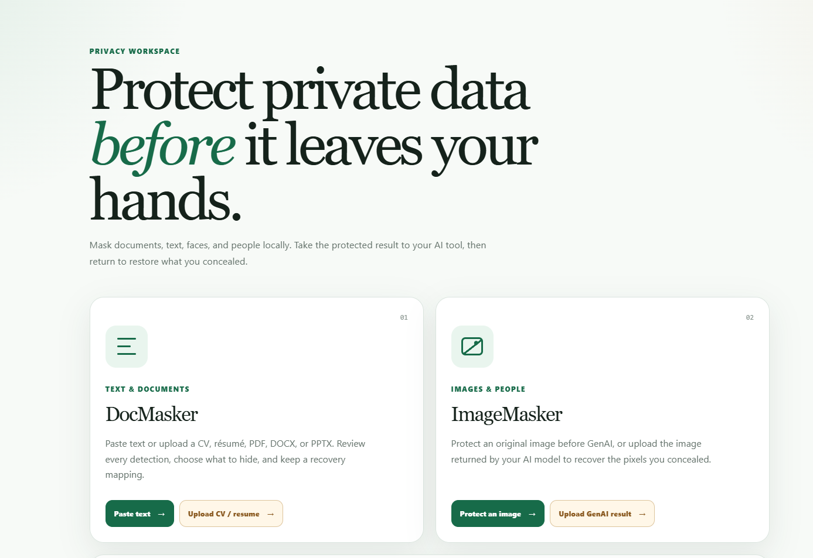
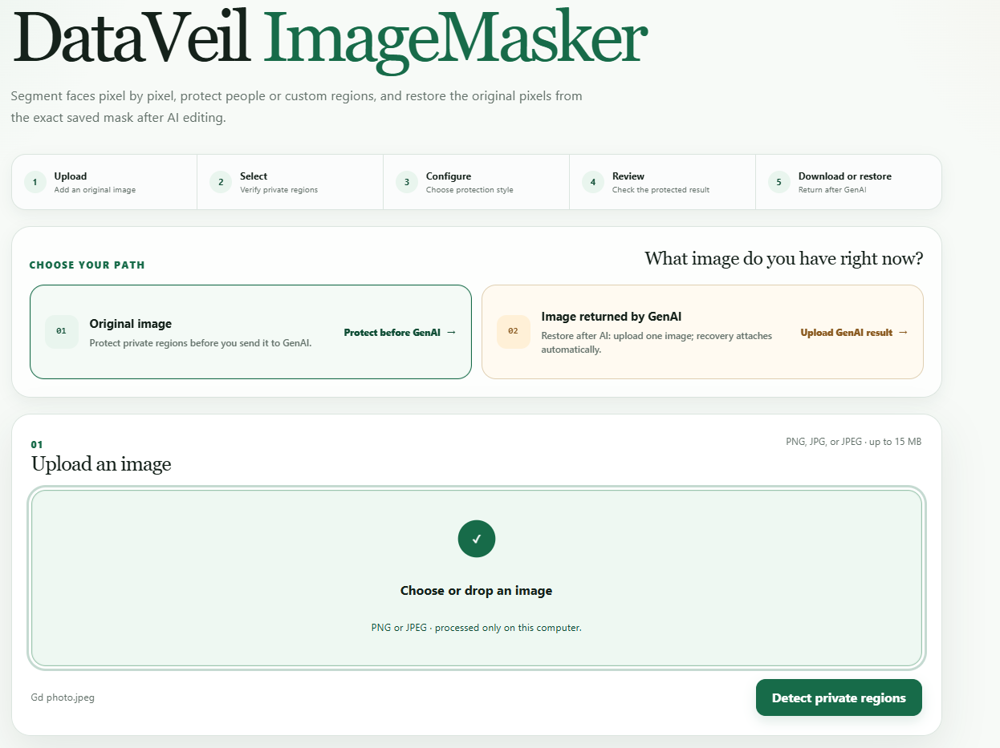
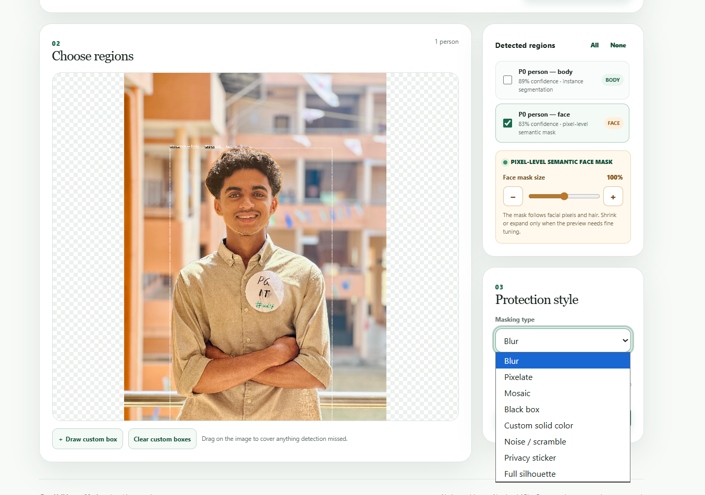
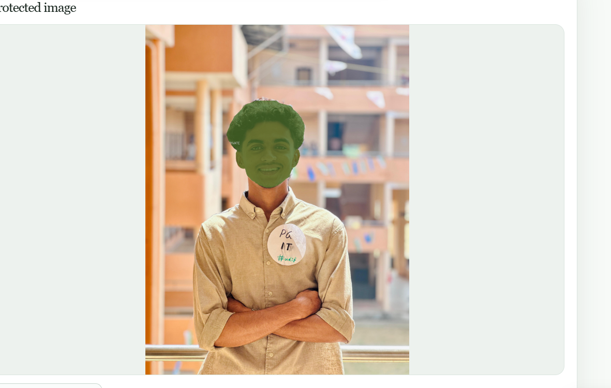
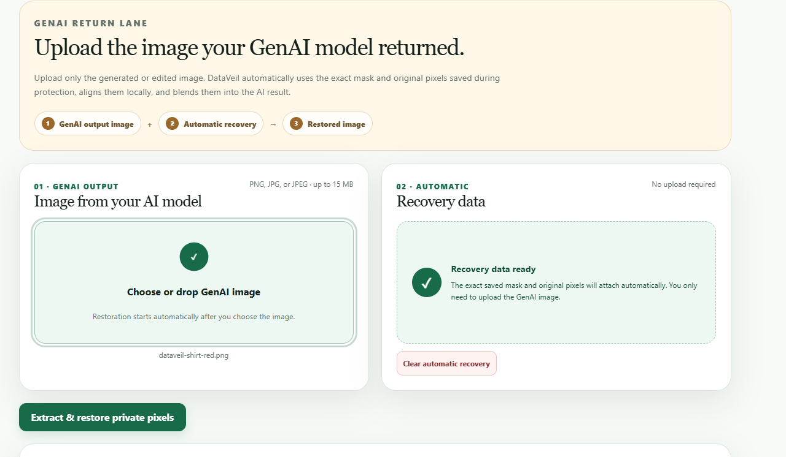
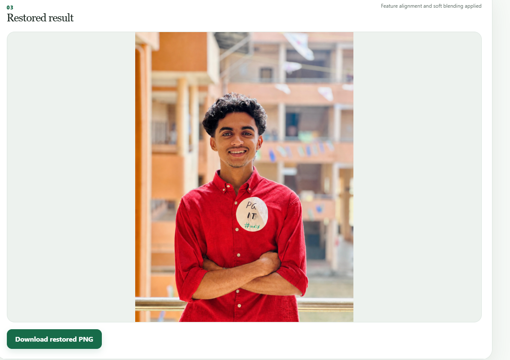
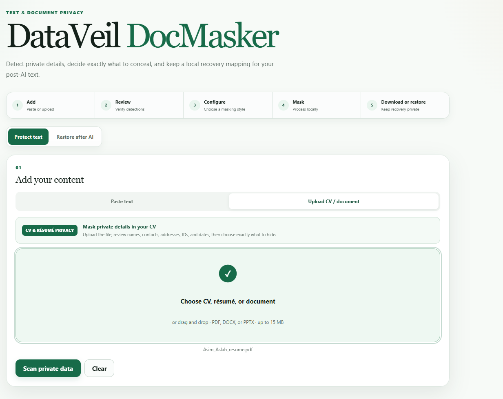
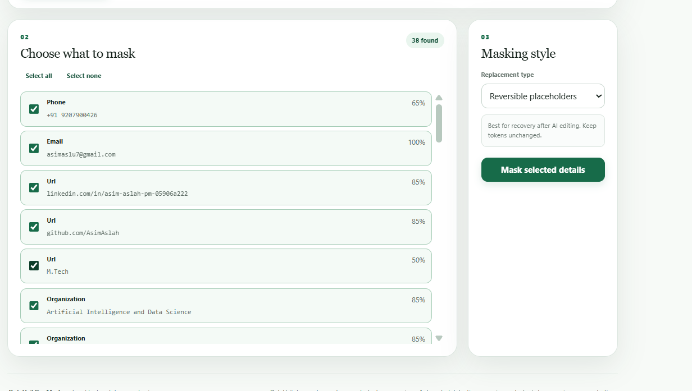
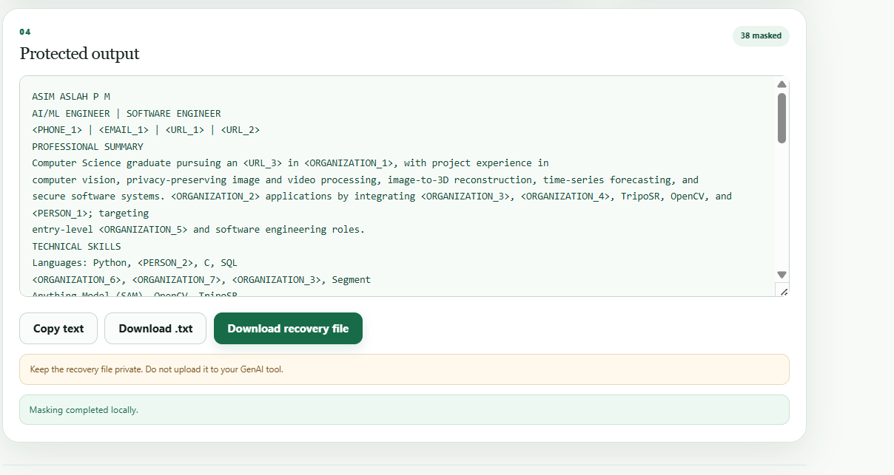

# DataVeil

DataVeil is one local FastAPI application for protecting text, documents, and
images before they are used with an external AI tool. It can later restore
protected text or image regions from recovery files held by the user.

The application uses one Uvicorn server, one port, and two `APIRouter`
modules:

- **DocMasker** — pasted text and PDF, DOCX, or PPTX uploads;
- **ImageMasker** — PNG, JPG, and JPEG images.

No cloud API, database, analytics service, or server-side upload history is
used.



## Features

### DocMasker

- local Presidio and spaCy detection;
- names, email addresses, phone numbers, organizations, locations, dates,
  IP addresses, URLs, cards, Aadhaar-like numbers, and Indian PIN codes;
- per-occurrence selection, plus select-all and select-none controls;
- reversible placeholders, typed redaction tokens, pseudonyms, generalized
  categories, and value removal;
- in-memory extraction from PDF, DOCX, and PPTX;
- masked-text and recovery-mapping downloads;
- restoration of tokens that remain in AI-edited text.

### ImageMasker

- local YOLO person segmentation using the bundled
  `ImageMasker/yolov8n-seg.pt`;
- local OpenCV face localization followed by pixel-level BiSeNet semantic
  face parsing using the bundled ResNet-18 weights;
- face, body, individual-person, and manually drawn region selection;
- blur, pixelate, mosaic, black box, custom color, noise, privacy sticker,
  and silhouette effects;
- effect-specific strength or opacity from 1–100%;
- masked PNG and recovery-kit downloads;
- post-AI restoration using the existing ORB/ECC alignment logic.

The image recovery package contains the exact binary semantic/instance
selection mask, a masked reference image, and only the original pixels inside
the protected regions. Restoration maps that saved mask and those saved
pixels onto the GenAI-returned image; it never reruns segmentation to guess
the face boundary. The package does not contain the complete original image.
Treat it as sensitive and never send it to an external AI service.

## ImageMasker Demo

### Upload



### Select Regions



### Choose Mask


### Protect



### GenAI Return



### Restore



## DocMasker Demo

### Upload



### Select Data



### Protect



## Architecture

```text
DataVeil/
├── main.py                         # only FastAPI application
├── templates/index.html            # DataVeil landing page
├── static/
├── DocMasker/
│   ├── router.py                   # /docmasker and /api/doc/*
│   ├── service.py
│   ├── extraction.py               # bounded in-memory document extraction
│   ├── detector.py
│   ├── masking.py
│   ├── restoration.py
│   ├── templates/
│   └── static/
├── ImageMasker/
│   ├── router.py                   # /imagemasker and /api/image/*
│   ├── service.py                  # in-memory web workflow
│   ├── unified_masker.py           # reusable detection/effect primitives
│   ├── unmasker.py                 # reusable alignment primitives
│   ├── yolov8n-seg.pt
│   ├── templates/
│   └── static/
├── tests/
└── requirements.txt
```

`DocMasker.main` no longer creates an application. It only exports the
DocMasker router for compatibility. The root `main.py` includes both routers
with `app.include_router()`.

## Windows installation

Python 3.10 or newer is required. Python 3.10 is the tested baseline.

```powershell
Set-Location C:\Users\asima\privacy
py -3.10 -m venv .venv
Set-ExecutionPolicy -Scope Process -ExecutionPolicy Bypass
.\.venv\Scripts\Activate.ps1
python -m pip install --upgrade pip
python -m pip install -r requirements.txt
```

Package installation needs internet access once. Runtime detection, masking,
download generation, and restoration are local.

## Run

From `C:\Users\asima\privacy`, activate the virtual environment and run
exactly:

```powershell
python -m uvicorn main:app --host 127.0.0.1 --port 8000 --reload
```

Open <http://127.0.0.1:8000>.

Do not bind DataVeil to a public or LAN interface when processing private
content.

## User workflow

### Protect and restore text

1. Open **DocMasker**.
2. Paste text or upload a supported document.
3. Scan, review detections, and deselect anything that should remain visible.
4. Choose a masking style.
5. Download both the masked text and recovery JSON.
6. Use only the masked text with the external AI tool.
7. Return to **Restore after AI**, paste the edited text, and add the recovery
   JSON.
8. Download the restored text.

Placeholder-based styles are the most reliable. AI tools may alter, delete,
or reorder pseudonyms, generalized values, and redaction tokens. Removed
values cannot be reliably recovered after structural edits.

### Protect and restore an image

1. Open **ImageMasker** and upload a PNG or JPEG.
2. Detect people and create pixel-level semantic face masks.
3. Select the people, faces, bodies, or custom boxes to protect.
4. Choose an effect and strength.
5. Download the masked PNG and recovery kit.
6. Send only the masked PNG to the external AI tool.
7. Return to **Restore after AI** with the edited image and recovery kit.
8. Download the restored PNG.

Restoration handles resizing and modest affine changes. Heavy cropping,
perspective changes, regenerated scenes, or deletion of the surrounding
background can make automatic alignment impossible or inaccurate.

## API routes

| Method | Route | Purpose |
|---|---|---|
| `GET` | `/` | DataVeil landing page |
| `GET` | `/docmasker` | DocMasker interface |
| `POST` | `/api/doc/detect` | Detect entities in pasted text |
| `POST` | `/api/doc/detect-file` | Extract and detect a document |
| `POST` | `/api/doc/mask` | Mask selected text entities |
| `POST` | `/api/doc/mask-file` | Extract and directly mask a document |
| `POST` | `/api/doc/restore` | Restore text from a local mapping |
| `GET` | `/imagemasker` | ImageMasker interface |
| `POST` | `/api/image/detect` | Detect people and face regions |
| `POST` | `/api/image/mask` | Apply a selected masking effect |
| `POST` | `/api/image/restore` | Restore an edited image from a recovery kit |
| `GET` | `/health` | Unified application health |

## Tests

```powershell
python -m pytest
```

The suite covers both interfaces, both routers in one application, selective
text masking and restoration, in-memory document uploads, valid image
uploads, every image effect, and image recovery.

## Privacy and security limits

- Uploaded values are read into bounded request memory and discarded.
- Starlette may spool larger multipart uploads to an operating-system
  temporary file; each `UploadFile` is explicitly closed after processing.
- DataVeil does not save uploaded content or recovery mappings.
- Browser previews and mappings remain in browser memory until cleared or
  closed.
- Automated detection can miss indirect or contextual identifiers.
- A recovery file contains private restoration material and must remain under
  the user's control.
- Review every output before sending it elsewhere.
